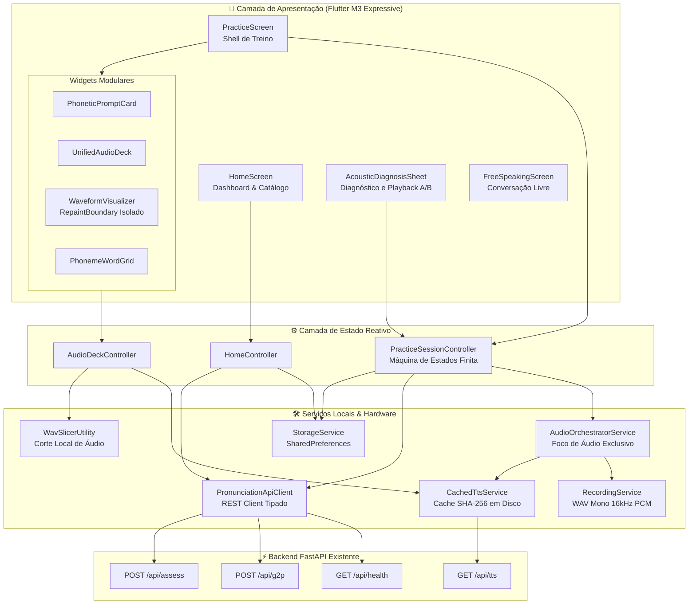
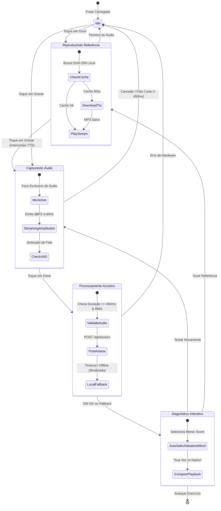
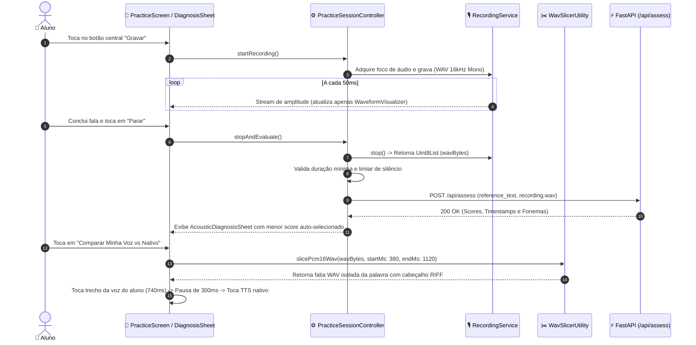
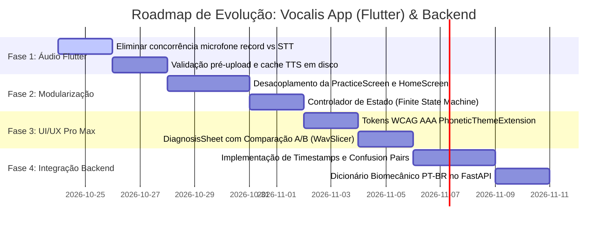

# Vocalis App (Flutter) — Arquitetura, Redesign UI/UX Pro Max & Especificação de Backend

> **Documento Técnico de Arquitetura e Engenharia de Software**  
> Análise aprofundada do aplicativo Flutter [`vocalis_app/`](file:///home/marcelo/Documentos/Meus/app-de-pronuncia/vocalis_app), contratos com o backend FastAPI e plano de ação sem modificação de código de backend nesta etapa.

---

## 1. Diagnóstico Arquitetural Crítico (`vocalis_app`)

A inspeção da estrutura do aplicativo Flutter revela um produto com recursos avançados de síntese e treino, mas sustentado por padrões que limitam sua estabilidade e escalabilidade em dispositivos móveis.

### 1.1 Monolitos de UI ("God Widgets") e Fragilidade de Estado
* **`practice_screen.dart` (1.527 linhas)** e **`home_screen.dart` (812 linhas)**:
  Ambos concentram simultaneamente renderização de layout, regras de negócio, timers de animação, orquestração de múltiplos reprodutores/gravadores de áudio e chamadas HTTP diretas.
* **Sobrecarga de `setState()`**:
  Na [`PracticeScreen`](file:///home/marcelo/Documentos/Meus/app-de-pronuncia/vocalis_app/lib/screens/practice_screen.dart), múltiplos processos assíncronos (stream de microfone, eventos de reconhecimento de fala, callbacks do `audioplayers` e respostas do backend) chamam `setState()` concorrentemente, causando reconstruções completas da tela a 60 FPS e risco de chamadas após `dispose()`.

### 1.2 Conflito Crítico de Hardware no Pipeline de Áudio
* **Disputa de Microfone (`record` vs `speech_to_text`)**:
  O aplicativo utiliza simultaneamente o `RecordingService` (pacote `record`) para capturar o áudio em arquivo e o `LiveTranscriptService` (pacote `speech_to_text`) para transcrição ao vivo.
  * **Efeito no Android/iOS**: No Android (`AudioRecord`) e no iOS (`AVAudioSession`), o subsistema nativo de fala frequentemente sequestra o foco exclusivo do microfone ou altera a taxa de amostragem durante a sessão, resultando em arquivos WAV mudos ou corrompidos enviados ao backend.

### 1.3 Gargalos de Formato e Fallback Silencioso
* **Formato de Envio**: O modelo `wav2vec2` opera nativamente em **WAV PCM 16-bit, 16.000 Hz, Mono**. Enviar formatos comprimidos ou com taxas arbitrárias força conversões no servidor ou degrada a precisão do alinhador.
* **Risco Pedagógico do Fallback Local**: No [`pronunciation_service.dart`](file:///home/marcelo/Documentos/Meus/app-de-pronuncia/vocalis_app/lib/services/pronunciation_service.dart), caso a requisição ao backend falhe por timeout ou rede, o método `_clientSideFallbackAssessment` gera notas fonéticas baseadas exclusivamente em comparação textual. Sem um indicativo explícito na interface, o aluno acredita estar recebendo uma avaliação acústica real por IA.

---

## 2. Auditoria dos Contratos Atuais com o Backend FastAPI

O `vocalis_app` consome a API do backend presente na raiz do repositório ([`backend/app/main.py`](file:///home/marcelo/Documentos/Meus/app-de-pronuncia/backend/app/main.py)) através dos seguintes contratos:

| Endpoint | Método | Payload Flutter | Resposta Backend | Limitações Atuais |
| :--- | :--- | :--- | :--- | :--- |
| `/api/health` | `GET` | Nenhum | `{"status": "ok", "engine": "wav2vec2", "model_loaded": bool}` | Não expõe latência média nem limites de carga do modelo. |
| `/api/tts` | `GET` | Query params: `text`, `voice`, `rate` | Stream binário `audio/mpeg` (Edge-TTS) | Não fornece cabeçalhos de cache (`ETag`), gerando downloads repetidos do mesmo áudio no treino em loop. |
| `/api/g2p` | `POST` | JSON: `{"text": string}` | `{"sentence": str, "phoneticIpa": str, "friendlyPhonetic": str, "words": [...]}` | O array `words` não traz o índice da sílaba tônica nem pronúncia amigável individual por palavra. |
| `/api/assess` | `POST` | Multipart: `reference_text` (form field), `audio_file` (WAV bytes) | JSON com scores globais, lista de palavras e fonemas avaliados | **Não retorna timestamps (`start_ms`, `end_ms`)** nem fonema substituído (`actual_phoneme`), impedindo o playback comparativo da palavra errada. |

---

## 3. Especificação de Tarefas para o Backend (Schema v2)

> [!IMPORTANT]
> **Diretriz de Escopo**: O código do backend **não foi alterado nesta etapa**. As tarefas abaixo definem a especificação técnica para implementação futura no servidor (`backend/app/`).

### 3.1 Contrato v2 do `POST /api/assess` (Retrocompatível)
O backend continuará atendendo aos campos existentes e adicionará marcações temporais e diagnóstico biomecânico:

```json
{
  "overall_score": 78,
  "accuracy_score": 74,
  "fluency_score": 82,
  "completeness_score": 100,
  "engine_source": "wav2vec2_ctc",
  "audio_quality_metrics": {
    "snr_db": 24.5,
    "duration_ms": 2340,
    "is_clipped": false
  },
  "transcript": "the tirty three thieves thought",
  "target_sentence": "The thirty-three thieves thought",
  "words": [
    {
      "word": "thirty-three",
      "spoken_word": "tirty-three",
      "status": "needsWork",
      "score": 58,
      "ipa": "/ˈθɜːrti θriː/",
      "friendly_phonetic": "tãr-ti trii",
      "start_ms": 380,
      "end_ms": 1120,
      "tip": "Atenção ao som inicial de 'th'. Evite fechá-lo como um 'T' seco.",
      "phonemes": [
        {
          "phoneme": "θ",
          "actual_phoneme": "t",
          "error_type": "substitution",
          "score": 32,
          "status": "needsWork",
          "start_ms": 380,
          "end_ms": 490,
          "tip": "Você pronunciou /t/ em vez de /θ/. Posicione a ponta da língua entre os dentes e sopre.",
          "biomechanics": {
            "tongue": "Ponta levemente projetada entre os dentes superiores e inferiores.",
            "airflow": "Contínuo e fricativo (deixe o ar escapar sem travar).",
            "voicing": "Desvozeado (cordas vocais relaxadas)."
          }
        }
      ]
    }
  ],
  "feedback_summary": "Excelente ritmo! Foque em destravar o fonema /θ/ na palavra 'thirty-three'.",
  "articulation_tip": "Para brasileiros, o desvio mais comum no /θ/ é bater a língua atrás dos dentes produzindo som de /t/."
}
```

### 3.2 Backlog de Tarefas do Backend (Para Fases Futuras)
1. **Tarefa BE-1 (Extração de Timestamps no Alinhador)**:
   Converter índices de frames da treliça Viterbi CTC do Wav2Vec2 para milissegundos (`frame_index * 20ms`), populando `start_ms` e `end_ms` por palavra e fonema.
2. **Tarefa BE-2 (Identificação de Substituição Fonética)**:
   Calcular a classe de maior probabilidade acústica concorrente no intervalo do fonema quando o score for inferior a 60, preenchendo `actual_phoneme` e `error_type` (`substitution`, `omission`).
3. **Tarefa BE-3 (Dicionário Biomecânico para Falantes de Português)**:
   Criar estrutura de dados no backend mapeando as dificuldades clássicas de brasileiros (sons de `th`, vogais curtas vs longas `/ɪ/` vs `/iː/`, Dark L `/ɫ/` e epênteses consonantais) em campos estruturados `tongue`, `airflow` e `voicing`.
4. **Tarefa BE-4 (Cache e Métricas de Áudio)**:
   Adicionar cabeçalho `Cache-Control: public, max-age=604800` no endpoint `/api/tts` e cálculo de SNR / saturação (`is_clipped`) no `/api/assess`.

---

## 4. Diagram Design: Arquitetura e Fluxos de Dados

### 4.1 Arquitetura Desacoplada do `vocalis_app`



### 4.2 Máquina de Estados Finita da Prática Guiada



### 4.3 Fluxo Sequencial de Gravação e Comparação A/B ("Ouça Seu Erro")



---

## 5. Proposta Visual e UI/UX Pro Max para Flutter

### 5.1 Tokens de Acessibilidade Fonética (`PhoneticThemeExtension`)
A nova paleta substitui cores planas de baixo contraste por tokens semânticos de alta legibilidade (WCAG AAA) combinados a identificadores geométricos para acessibilidade de daltonismo:

| Status Fonético | Cor (Light) | Fundo (Light) | Razão Contraste | Indicador Visual |
| :--- | :--- | :--- | :--- | :--- |
| **Mastered (Domínio)** | `#0D9488` (Teal 600) | `#CCFBF1` (Teal 100) | **7.42:1 (AAA)** | Ícone `✓` e sublinhado contínuo |
| **Near (Aproximado)** | `#D97706` (Amber 600) | `#FEF3C7` (Amber 100) | **7.15:1 (AAA)** | Ícone `•` e sublinhado tracejado |
| **Needs Work (Crítico)** | `#E11D48` (Rose 600) | `#FFE4E6` (Rose 100) | **7.68:1 (AAA)** | Ícone `!` e sublinhado duplo ondulado |

### 5.2 Tipografia Especializada para IPA
Para evitar o problema de glifos ausentes ou desalinhados no Android, a estilização fonética passa a utilizar:
```dart
const TextStyle ipaTextStyle = TextStyle(
  fontFamily: 'Noto Sans',
  fontFamilyFallback: ['Inter', 'SF Pro Text', 'Roboto', 'sans-serif'],
  fontSize: 18,
  letterSpacing: 0.6,
  color: Color(0xFF475569),
);
```

### 5.3 Deck de Áudio Ergonômico na Thumb Zone
O controle inferior da `PracticeScreen` é fixado na zona do polegar com altura de `88dp`:
* **Botão Central de Microfone (72x72dp)**: Contorno pulsante reativo à intensidade vocal (`dBFS`).
* **Botões Satélites (48x48dp)**: Controle rápido de velocidade (0.75x / 1.0x) à esquerda e reprodução de referência à direita.

### 5.4 Utilitário de Corte Local de Áudio (`WavSlicer`)
Implementado em Dart puro sem dependência de FFmpeg, permitindo reproduzir qualquer palavra isolada da gravação a partir dos timestamps:

```dart
// lib/utils/wav_slicer.dart
import 'dart:typed_data';

class WavSlicer {
  static const int _wavHeaderSize = 44;

  static Uint8List? slicePcm16Wav({
    required Uint8List sourceWav,
    required int startMs,
    required int endMs,
    int sampleRate = 16000,
    int channels = 1,
  }) {
    if (sourceWav.length <= _wavHeaderSize || endMs <= startMs) return null;

    final int bytesPerSample = 2; // 16-bit PCM
    final int byteRate = sampleRate * channels * bytesPerSample;
    final int blockAlign = channels * bytesPerSample;

    int startByte = _wavHeaderSize + ((startMs * byteRate) ~/ 1000);
    int endByte = _wavHeaderSize + ((endMs * byteRate) ~/ 1000);

    startByte -= (startByte - _wavHeaderSize) % blockAlign;
    endByte -= (endByte - _wavHeaderSize) % blockAlign;

    startByte = startByte.clamp(_wavHeaderSize, sourceWav.length);
    endByte = endByte.clamp(startByte, sourceWav.length);

    final int payloadLength = endByte - startByte;
    if (payloadLength <= 0) return null;

    final Uint8List slicedWav = Uint8List(_wavHeaderSize + payloadLength);
    slicedWav.setRange(0, _wavHeaderSize, sourceWav);
    slicedWav.setRange(_wavHeaderSize, slicedWav.length, sourceWav, startByte);

    final ByteData headerView = ByteData.sublistView(slicedWav, 0, _wavHeaderSize);
    headerView.setUint32(4, 36 + payloadLength, Endian.little);
    headerView.setUint32(40, payloadLength, Endian.little);

    return slicedWav;
  }
}
```

---

## 6. Plano de Ação em Fases



### Resumo das Fases:
1. **Fase 1 (Saneamento do Áudio no Flutter)**:
   * Desativar a escuta paralela de STT durante a gravação para eliminar áudios mudos.
   * Padronizar a gravação em WAV PCM Mono 16kHz.
   * Adicionar cache local de arquivos TTS indexado por hash SHA-256.
2. **Fase 2 (Refatoração de Widgets Monolíticos no Flutter)**:
   * Quebrar [`PracticeScreen`](file:///home/marcelo/Documentos/Meus/app-de-pronuncia/vocalis_app/lib/screens/practice_screen.dart) em 5 sub-widgets independentes com `RepaintBoundary` no visualizador de onda.
   * Implementar `PracticeSessionController` com estados tipados herméticos.
3. **Fase 3 (UI/UX Pro Max & Diagnóstico Comparativo no Flutter)**:
   * Aplicar os tokens de tema `PhoneticThemeExtension` e tipografia `Noto Sans` para IPA.
   * Substituir o modal de feedback pelo `AcousticDiagnosisSheet` com auto-seleção de erro e comparador A/B.
4. **Fase 4 (Atualização do Backend FastAPI — Sem Alterações Agora)**:
   * Executar as tarefas especificadas na Seção 3.2 para fornecer timestamps reais (`start_ms`, `end_ms`) e fonema substituído (`actual_phoneme`) via Wav2Vec2 CTC.
