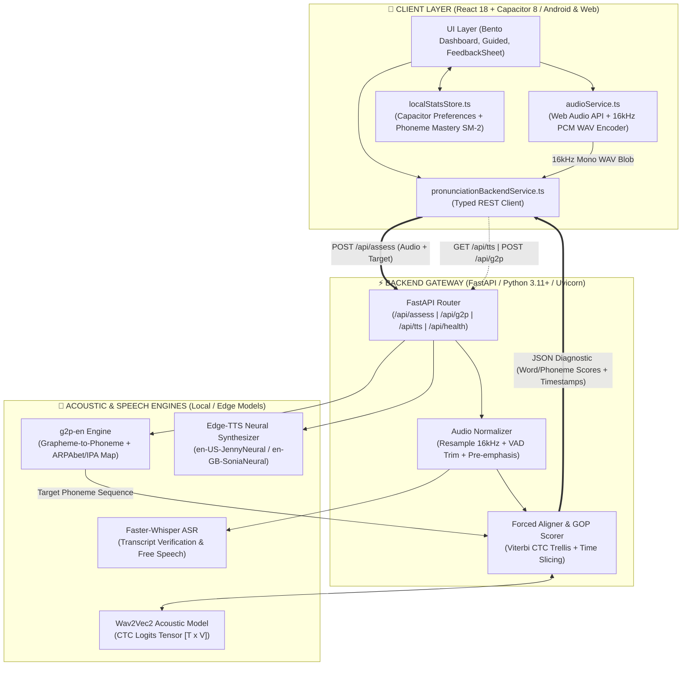
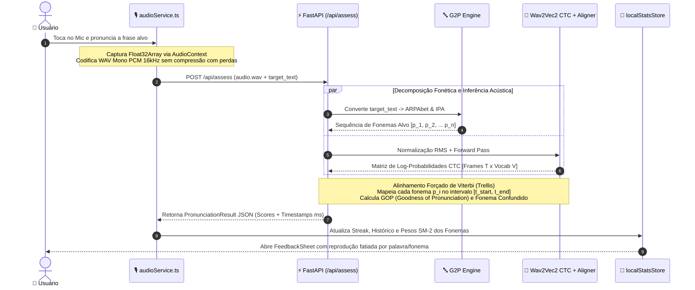
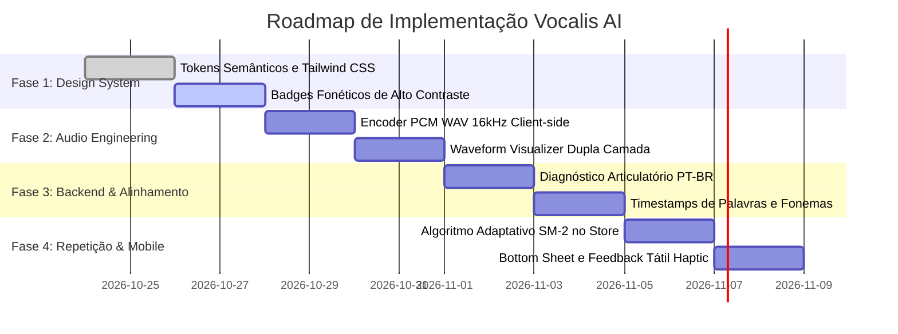

# Vocalis AI — Redesign Visual, Arquitetura e Engenharia Acústica

> **Diagnóstico & Especificação Técnica**  
> Aplicação das skills **Argon Subagent** (raciocínio profundo), **UI/UX Pro Max** (Design Intelligence) e **Diagram Design** (Arquitetura & Fluxos).

---

## 1. Diagnóstico Crítico do Design e Arquitetura Atual

### 1.1 Falhas de Acessibilidade e Contraste (WCAG AA/AAA)
No [`tailwind.config.js`](file:///home/marcelo/Documentos/Meus/app-de-pronuncia/tailwind.config.js), os tokens de feedback fonético utilizam cores saturadas sobre fundos pastéis com contraste insuficiente:
* **Verde (`#10b981` sobre `#ecfdf5`)**: Razão de contraste de **2.25:1** (reprovado no WCAG AA, que exige mínimo de 4.5:1).
* **Âmbar (`#f59e0b` sobre `#fffbeb`)**: Razão de contraste de **2.11:1** (crítico — ilegível em telas móveis sob luz solar).
* **Vermelho (`#ef4444` sobre `#fef2f2`)**: Razão de contraste de **3.67:1** (insuficiente para símbolos fonéticos finos como `/θ/`, `/ð/`, `/ɪ/`).

> [!IMPORTANT]
> Símbolos do Alfabeto Fonético Internacional (IPA) possuem traços finos e diacríticos delicados. Baixo contraste compromete diretamente a assimilação imediata do erro articulatório.

### 1.2 Tipografia e Renderização de Glifos IPA
* O uso de `Plus Jakarta Sans` e `JetBrains Mono` atende interfaces gerais, mas sofre com substituição de glifos IPA complexos (`/æ/`, `/ʊ/`, `/ŋ/`, `/ʒ/`, `/θ/`) no Android pelo fallback do sistema, gerando oscilação na linha de base (*baseline jitter*) e pesos visuais irregulares.

### 1.3 Ergonomia e Fricção de Interação
* **Desconexão de Navegação**: O [`BottomNav.tsx`](file:///home/marcelo/Documentos/Meus/app-de-pronuncia/src/components/layout/BottomNav.tsx) possui 4 abas, enquanto o [`App.tsx`](file:///home/marcelo/Documentos/Meus/app-de-pronuncia/src/App.tsx) manipula 5 estados de tela. Abrir o feedback como rota ou modal destacado quebra o fluxo de correção rápida (*Ouvir → Falar → Ajustar*).
* **Congelamento Articulatório no [`GuidedScreen.tsx`](file:///home/marcelo/Documentos/Meus/app-de-pronuncia/src/components/guided/GuidedScreen.tsx)**: Exibir transcrição ao vivo durante a fala desvia a atenção da pronúncia correta e altera a prosódia natural do estudante.
* **Ausência de Feedback Biomecânico no [`FeedbackModal.tsx`](file:///home/marcelo/Documentos/Meus/app-de-pronuncia/src/components/feedback/FeedbackModal.tsx)**: O modal atual exibe notas (`0–100`), mas não fornece orientações acionáveis em português sobre *como* posicionar a língua, dentes ou lábios para corrigir o som.

---

## 2. Nova Proposta Visual (UI/UX Pro Max)

O novo sistema visual adota **Material 3 Expressive** com estrutura em **Bento Grid Tátil**, priorizando legibilidade, ergonomia mobile e contraste estrito.

### 2.1 Paleta Semântica Fonética de Alta Precisão (WCAG AAA/AA)

| Estado Fonético | Faixa de Score | Fundo (`bg`) | Borda (`border`) | Texto (`text`) | Indicador (`accent`) | Contraste (Texto/Bg) |
| :--- | :--- | :--- | :--- | :--- | :--- | :--- |
| **Mastered (Domínio)** | `80 – 100` | `#ECFDF5` | `#A7F3D0` | `#065F46` | `#10B981` | **7.54:1 (AAA)** |
| **Near (Aproximado)** | `55 – 79` | `#FFFBEB` | `#FDE68A` | `#92400E` | `#F59E0B` | **7.18:1 (AAA)** |
| **Needs Work (Crítico)** | `0 – 54` | `#FEF2F2` | `#FECACA` | `#991B1B` | `#EF4444` | **7.82:1 (AAA)** |
| **Target IPA (Neutro)** | — | `#F1F5F9` | `#E2E8F0` | `#334155` | `#6366F1` | **8.40:1 (AAA)** |

### 2.2 Hierarquia Tipográfica
* **Títulos e Interface**: `Plus Jakarta Sans` (pesos 600, 700, 800).
* **Transcrição Fonética (IPA)**: `Inter`, `Noto Sans`, com fallback para `Gentium Plus` / `Charis SIL` (sem itálico, garantindo geometria fiel de símbolos como `/ʃ/` e `/ʒ/`).
* **Métricas e Temporizações**: `JetBrains Mono` para porcentagens, durações e decibéis.

### 2.3 Especificações dos Componentes Centrais

#### Botão de Gravação (`<MicTrigger />`)
* **Posicionamento**: Thumb Zone inferior central (diâmetro 72px, `rounded-full`).
* **Estados**:
  1. `IDLE`: Indigo vibrante (`#4F46E5`), sombra de elevação suave, feedback tátil `navigator.vibrate(12)`.
  2. `RECORDING`: Vermelho coral (`#EF4444`), anel pulsante concêntrico e ocultação de transcrição ao vivo para eliminar distração.
  3. `PROCESSING`: Slate escuro (`#0F172A`) com anel giratório orbital contínuo.
  4. `COMPLETED`: Vibração dupla curta e abertura do painel deslizante de diagnóstico.

#### Visualizador de Onda Dupla Camada (`<WaveformVisualizer />`)
* **Camada Envoltória (Fantasma)**: Silhueta cinza claro (`#CBD5E1`) com a amplitude e prosódia de referência gerada pelo áudio nativo.
* **Camada Dinâmica (Voz do Usuário)**: Barras verticais fluidas a 60 FPS conectadas ao `AnalyserNode` da Web Audio API.

#### Badges Fonéticos Interativos (`<PhonemeBadge />`)
* Cápsula contendo o símbolo alvo, barra de progresso e score.
* **Detecção de Par de Confusão**: Indica substituição articulatória quando detectada pelo alinhador (ex: `/θ/ → /t/`).
* **Tap-to-Inspect**: Toque revela dica anatômica concisa em português e permite tocar isoladamente o trecho de áudio do usuário versus a referência nativa.

---

## 3. Arquitetura do Sistema e Fluxos Operacionais (Diagram Design)

Seguindo o padrão **Diagram Design** (densidade editorial 4/10, nós estruturados e fluxo de dados com semântica precisa de cores):

### 3.1 Arquitetura Global do Sistema

---

### 3.2 Fluxo Sequencial de Avaliação Acústica

---

### 3.3 Formulação Matemática do GOP (*Goodness of Pronunciation*)

Para um fonema alvo $p$ alinhado no intervalo de frames $[t_1, t_2]$ com duração $D = t_2 - t_1 + 1$:

$$\text{GOP}(p) = \frac{1}{D} \sum_{t=t_1}^{t_2} \left( \log P(p \mid x_t) - \max_{q \in V} \log P(q \mid x_t) \right)$$

* Se o fonema for produzido corretamente: $\log P(p \mid x_t) \approx \max_q \log P(q \mid x_t) \implies \text{GOP}(p) \approx 0 \implies \mathbf{95–100\%}$.
* Se outra classe fonética $q^*$ dominar o intervalo, o sistema detecta a substituição e armazena em `actualPhoneme` para oferecer a dica corretiva específica.

---

## 4. Plano de Implementação (Roadmap em 4 Fases)

### Detalhamento das Entregas:

1. **Fase 1 — Design System e Acessibilidade (Dias 1–3)**:
   - Atualizar [`tailwind.config.js`](file:///home/marcelo/Documentos/Meus/app-de-pronuncia/tailwind.config.js) com os tokens fonéticos contrastantes e família de fontes IPA.
   - Refatorar [`FeedbackModal.tsx`](file:///home/marcelo/Documentos/Meus/app-de-pronuncia/src/components/feedback/FeedbackModal.tsx) para Bottom Sheet com Popover articulatório.
   - Reestruturar o [`DashboardScreen.tsx`](file:///home/marcelo/Documentos/Meus/app-de-pronuncia/src/components/dashboard/DashboardScreen.tsx) no padrão Bento Grid assimétrico.

2. **Fase 2 — Engenharia de Áudio no Cliente (Dias 4–6)**:
   - Implementar codificador WAV PCM 16kHz nativo em [`src/services/audioService.ts`](file:///home/marcelo/Documentos/Meus/app-de-pronuncia/src/services/audioService.ts) via `AudioWorklet`/`ScriptProcessor`, eliminando distorções de WebM/Opus.
   - Implementar o visualizador de onda em dupla camada (silhueta de referência + fala em tempo real).

3. **Fase 3 — Backend de Alinhamento e Dicas Biomecânicas (Dias 7–9)**:
   - Criar módulo [`backend/app/articulatory_tips.py`](file:///home/marcelo/Documentos/Meus/app-de-pronuncia/backend/app) com remediações específicas para fonemas desafiadores para lusófonos (`/θ/`, `/ð/`, `/æ/`, `/ɪ/`, `/iː/`, `/ʊ/`, `/ɹ/`, `/ŋ/`).
   - Retornar marcações temporais (`startMs`, `endMs`) para permitir reprodução isolada de qualquer palavra ou fonema.

4. **Fase 4 — Repetição Espaçada e Polimento Mobile (Dias 10–12)**:
   - Atualizar [`src/storage/localStatsStore.ts`](file:///home/marcelo/Documentos/Meus/app-de-pronuncia/src/storage/localStatsStore.ts) com ponderação exponencial para priorizar fonemas com domínio inferior a 70%.
   - Integrar `@capacitor/haptics` para reforço tátil no início da fala, término e acerto articulatório.
